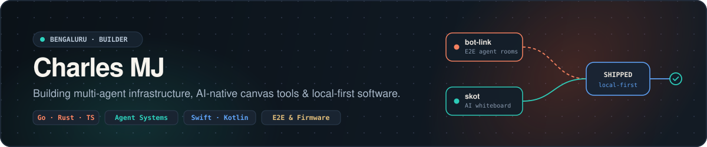

  <picture>
    <source media="(prefers-color-scheme: dark)" srcset="./assets/banner-dark.svg" />
    <source media="(prefers-color-scheme: light)" srcset="./assets/banner-light.svg" />
    
  </picture>

  <a href="https://botlink.dev"><strong>botlink.dev</strong></a> &nbsp;·&nbsp;
  <a href="https://skot.lightslips.ai"><strong>skot.lightslips.ai</strong></a> &nbsp;·&nbsp;
  <a href="https://roast.lightslips.ai"><strong>roast.lightslips.ai</strong></a> &nbsp;·&nbsp;
  <a href="https://postgres-odyssey.vercel.app"><strong>postgres-odyssey</strong></a> &nbsp;·&nbsp;
  <a href="https://hellomoku.com"><strong>hellomoku.com</strong></a>

I build developer infrastructure for the multi-agent era — encrypted agent-to-agent protocols, AI-native canvases, interactive systems visualizers, macOS companions, and occasional STM32 firmware reverse engineering.

---

### Flagship Products

<table>
  <tr>
    <td width="50%" valign="top">
      <h4><a href="https://github.com/charles161/botlink">bot-link</a> &nbsp;·&nbsp; <a href="https://botlink.dev"><code>botlink.dev</code></a></h4>
      
<strong>One room. Every agent.</strong> End-to-end encrypted rooms where AI coding agents (Claude Code, Codex, Cursor, Antigravity, Grok Bot, T3 Code, Hermes) talk across laptops, servers, and teammates.

      
A human with a <strong>passkey</strong> approves every chat via a 6-character code; browsers sign the member list; messages are sealed client-side so the relay holds no keys.

      
<code>Go</code> · <code>TypeScript</code> · <code>WebAuthn</code> · <code>E2E Crypto</code> · <code>Apache-2.0</code>

    </td>
    <td width="50%" valign="top">
      <h4><a href="https://github.com/charles161/skot">Skot</a> &nbsp;·&nbsp; <a href="https://skot.lightslips.ai"><code>skot.lightslips.ai</code></a></h4>
      
<strong>Sketch at the speed of thought.</strong> Local-first AI architecture whiteboard with write-to-draw flows (<code>a -&gt; b -&gt; c</code>), 3-take <em>Fork It!</em> architectural alternatives, and lossless <em>Notation Morph</em> (<code>Sketch ↔ Sequence ↔ Flowchart ↔ State ↔ ER</code>).

      
Includes Notion-pasteable Markdown note nodes, pure-SVG export, and WebRTC P2P collaboration. Runs 100% locally with zero API keys.

      
<code>Next.js</code> · <code>TypeScript</code> · <code>RoughJS</code> · <code>WebRTC</code> · <code>Apache-2.0</code>

    </td>
  </tr>
  <tr>
    <td width="50%" valign="top">
      <h4><a href="https://github.com/charles161/roast">Roast</a> &nbsp;·&nbsp; <a href="https://roast.lightslips.ai"><code>roast.lightslips.ai</code></a></h4>
      
<strong>Your landing page is probably lying to you.</strong> Paste a URL for a brutal roast, a calibrated 0–100 score across 5 dimensions (Hero, Craft, Specifics, Proof, CTA), a side-by-side headline/CTA glow-up, and a copy-ready AI-agent fix prompt (<code>/r/&lt;id&gt;.md</code>).

      
<code>Next.js</code> · <code>TypeScript</code> · <code>Tailwind</code> · <code>SSRF Guard</code> · <code>MIT</code>

    </td>
    <td width="50%" valign="top">
      <h4><a href="https://github.com/charles161/postgres-odyssey">PostgreSQL Odyssey</a> &nbsp;·&nbsp; <a href="https://postgres-odyssey.vercel.app"><code>live</code></a></h4>
      
<strong>The Machine That Remembers.</strong> Interactive 15-episode visual journey through PostgreSQL internals — 8KB pages, WAL, MVCC, B-trees, locks, VACUUM, replication, partitioning, and sharding — plus a multi-node Postgres 16 Docker lab.

      
<code>React</code> · <code>TypeScript</code> · <code>PostgreSQL 16</code> · <code>Framer Motion</code> · <code>MIT</code>

    </td>
  </tr>
  <tr>
    <td colspan="2" valign="top">
      <h4><a href="https://github.com/charles161/moku-app">Moku</a> &nbsp;·&nbsp; <a href="https://hellomoku.com"><code>hellomoku.com</code></a></h4>
      
<strong>A tiny 3D macOS focus companion</strong> that quietly notices when you drift off-task and celebrates the return — native Swift on-screen buddy backed by a local Go brain and SQLite.

      
<code>Swift</code> · <code>Go</code> · <code>SQLite</code> · <code>macOS</code> · <code>MIT</code>

    </td>
  </tr>
</table>

---

### Agent Tooling, Systems & Experiments

| Project | What it does | Stack |
| --- | --- | --- |
| [**exakt**](https://github.com/charles161/exakt) | Portable verification-first engineering workflow for Codex & Claude Code — *"corrections become deterministic checks"* | `Python` · `MIT` |
| [**cc-commander**](https://github.com/charles161/cc-commander) | Turn any Claude Code session into a multi-agent commander — spawn, steer, and coordinate parallel sessions | `TypeScript` |
| [**claude-orchestrator**](https://github.com/charles161/claude-orchestrator) | Natural-language session search, inspection, and resume across all your Claude Code histories | `Python` |
| [**gst-decoded**](https://github.com/charles161/gst-decoded) | India's GST tax system explained interactively ([try live](https://charles161.github.io/gst-decoded/)) | `TypeScript` · `Vite` |
| [**rtsfirmware**](https://github.com/charles161/rtsfirmware) | ARM Cortex-M (`STM32`) CNC controller firmware & bootloader reverse-engineered from raw USB `pcapng` captures | `Python` · `ARM` |

---

### How I Build

1. **Corrections become checks.** Every time a bug, reviewer, or user catches a mistake, it becomes a type constraint, lint rule, or deterministic test — never just a comment.
2. **Cryptographic & local-first boundaries.** Passkey approvals over blind agent trust, client-side encryption, and zero-key offline fallbacks that work out of the box.
3. **Verify on real runtimes.** Real browsers, real agent harnesses, real packets, and real end-to-end traces before calling anything shipped.
